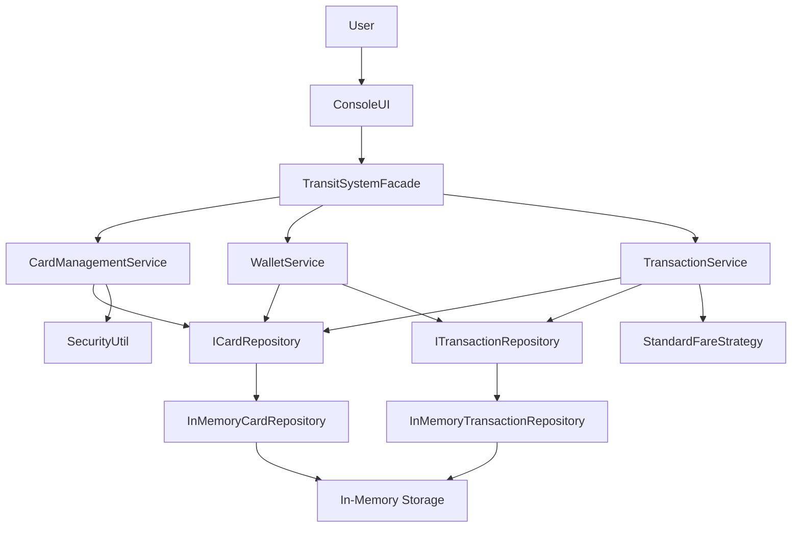

# Smart Card Transit System
### Java | Object-Oriented Programming | Design Patterns

## 1. Project Overview

The **Smart Card Transit System** is a Java-based public transportation card management application developed collaboratively as a final project for our university Object-Oriented Programming (OOP) course.

The application simulates a smart card payment system for public transportation in Izmir, Turkey. It allows passengers to register transportation cards, authenticate themselves, manage their wallet balances, purchase subscriptions, pay transportation fares, and review their transaction history.

The system supports three passenger categories and three transportation methods, implementing different pricing and discount rules depending on the passenger's profile and selected transportation method.

The primary objective of this project was to apply object-oriented programming principles, software design patterns, abstraction, inheritance, polymorphism, encapsulation, and layered software architecture to a practical real-world scenario.

## 2. Project Objectives

The main objectives of this project were:

- Apply the four fundamental principles of object-oriented programming.
- Design a modular application using separation of concerns.
- Implement appropriate software design patterns.
- Develop a transportation card management system with realistic business rules.
- Implement passenger authentication and PIN hashing.
- Manage wallet balances, subscriptions, and transactions.
- Use interfaces and dependency injection to achieve loose coupling.
- Practice unit testing and software validation.
- Develop maintainable and extensible Java code.

## 3. Main Features

### 3.1 Smart Card Registration

Passengers can register and create a new transportation smart card.

The registration process includes:

- Selecting a passenger profile.
- Entering personal information.
- Providing a Turkish identification number (TC Kimlik).
- Providing a valid Turkish mobile phone number.
- Creating and confirming a six-digit PIN.
- Generating a unique 11-digit smart card number.

Card numbers are generated with different prefixes depending on the passenger category:

| Passenger Type | Card Number Prefix |
|---|---|
| Standard | 10 |
| Student | 21 |
| Senior | 32 |

The application validates the input information before creating a card.

### 3.2 User Authentication

The application provides a login system based on:

- An 11-digit smart card number.
- A six-digit PIN.

PINs are hashed using the SHA-256 algorithm before being stored in the smart card object.

During authentication, the provided PIN is hashed and compared with the stored hash.

### 3.3 Passenger Profiles

The application supports three passenger categories.

| Profile | Discount Rate | Fare |
|---|---:|---|
| Standard | 0% | Full fare |
| Student | 50% | Half fare |
| Senior | 100% | Free |

Passenger profiles are implemented through an abstract parent class and specialized subclasses.

### 3.4 Wallet Management

Each smart card contains a wallet balance.

Users can:

- Add money to their cards.
- Select predefined top-up amounts.
- Enter a custom top-up amount.
- Check their current balance.

The application enforces the following wallet restrictions:

- Top-up amounts must be greater than zero.
- The maximum card balance is 5,000 TL.
- Users cannot spend more money than their available balance.

### 3.5 Transportation Fare Calculation

The system supports three transportation methods:

- Bus
- Ferry
- Railway (Metro)

The standard transportation fares are:

| Transportation Method | Base Fare |
|---|---:|
| Bus | 15 TL |
| Ferry | 20 TL |
| Railway | 12 TL |

The final fare is calculated according to the passenger's discount rate.

**Fare calculation formula:**

Final Fare = Base Fare × (1 − Discount Rate)

For example:

A student using the bus pays:

15 × (1 − 0.50) = 7.50 TL

A senior passenger receives a 100% discount and therefore travels free of charge.

The fare calculation is implemented using the Strategy Design Pattern.

### 3.6 Student Monthly Subscription

The application includes a monthly subscription specifically for student passengers.

| Subscription Property | Value |
|---|---:|
| Subscription Price | 740 TL |
| Initial Credits | 100 |
| Validity Period | 30 Days |
| Eligible Passengers | Students Only |

Transportation credit consumption:

| Transportation Method | Credits Required |
|---|---:|
| Bus | 1 |
| Railway | 2 |
| Ferry | 3 |

When a passenger uses their card:

1. The system checks whether the card has an active subscription.
2. If sufficient subscription credits are available, the required credits are deducted.
3. If the subscription is unavailable or has insufficient credits, the system calculates the regular fare.
4. The regular fare is deducted from the passenger's wallet if sufficient funds are available.
5. The transaction is recorded.

Only passengers with a Student profile can purchase the monthly subscription.

### 3.7 Transaction History

The application maintains transaction records for each smart card.

Supported transaction types include:

- TAP_IN
- TAP_OUT
- TOP_UP
- BUY_PASS

The system records transaction information such as:

- Transaction ID.
- Smart card ID.
- Transaction amount.
- Transportation method.
- Transaction type.
- Transaction timestamp.

Users can view their latest 10 transactions through the console interface.

### 3.8 Smart Card State Management

The application implements a card state management mechanism.

Three states are supported:

| State | Behavior |
|---|---|
| Active | Allows transportation access |
| Suspended | Denies transportation access |
| Blocked | Permanently denies transportation access |

Cards can transition between Active and Suspended states. A card can also be permanently blocked.

This functionality is implemented using the State Design Pattern.

## 4. System Architecture

The project follows a layered architecture that separates application responsibilities into different packages.

### Architecture Diagram



### 4.1 Domain Layer

Package: `com.transit.domain`

This layer contains the core business entities and domain logic.

Main classes:

| Class | Responsibility |
|---|---|
| SmartCard | Represents a transportation smart card |
| PassengerProfile | Abstract passenger profile |
| StandardProfile | Standard passenger implementation |
| StudentProfile | Student passenger implementation |
| SeniorProfile | Senior passenger implementation |
| Subscription | Manages monthly subscription credits and expiry |
| Transaction | Represents a financial or transportation transaction |
| CardState | Defines the smart card state contract |
| ActiveState | Implements active card behavior |
| SuspendedState | Implements suspended card behavior |
| BlockedState | Implements blocked card behavior |
| TransitModality | Defines available transportation methods |
| TransactionType | Defines transaction categories |

### 4.2 Service Layer

Package: `com.transit.service`

This layer contains the application's business operations.

| Class | Responsibility |
|---|---|
| CardManagementService | Card registration and authentication |
| WalletService | Wallet top-ups and monthly subscriptions |
| TransactionService | Transportation transactions and fare processing |
| TransitSystemFacade | Coordinates the application services |
| ProfileFactory | Creates passenger profile objects |
| IFareCalculationStrategy | Defines the fare calculation contract |
| StandardFareStrategy | Implements standard fare calculation |

### 4.3 Infrastructure Layer

Package: `com.transit.infrastructure`

This layer handles data storage abstractions and supporting infrastructure.

| Class | Responsibility |
|---|---|
| ICardRepository | Defines smart card storage operations |
| InMemoryCardRepository | Stores smart cards in memory |
| ITransactionRepository | Defines transaction storage operations |
| InMemoryTransactionRepository | Stores transaction records in memory |
| SecurityUtil | Provides PIN hashing functionality |

### 4.4 Presentation Layer

Package: `com.transit.presentation`

`ConsoleUI` is responsible for interacting with the user.

It provides:

- Login and registration menus.
- User dashboard.
- Wallet management interface.
- Subscription purchase interface.
- Transportation selection.
- Transaction history display.
- Input validation and error messages.

### 4.5 Main Layer

Package: `com.transit.main`

`TransitApplication` is the application's entry point.

It initializes the repositories, creates the service objects, injects their dependencies, initializes the facade, and starts the console interface.

### 4.6 Test Layer

Package: `com.transit.test`

`TransitSystemTestSuite` contains automated unit tests written using JUnit 4.

## 5. Object-Oriented Programming Principles

One of the primary goals of this university project was to demonstrate the four fundamental principles of OOP.

### 5.1 Encapsulation

Encapsulation protects the internal state of objects and controls how other classes interact with them.

For example, the `SmartCard` class keeps its balance private.

```java
private double balance;
```

External classes cannot directly modify the balance.

Instead, the class provides controlled methods:

```java
public boolean addBalance(double amount)

public boolean deductBalance(double amount)
```

These methods enforce business constraints and prevent invalid balance operations.

### 5.2 Inheritance

Inheritance allows specialized classes to reuse and extend the functionality of a parent class.

The project implements inheritance through the `PassengerProfile` hierarchy.

```text
          PassengerProfile
                 |
       +---------+---------+
       |         |         |
   Standard   Student    Senior
   Profile    Profile    Profile
```

`PassengerProfile` is an abstract class containing common passenger information.

The subclasses inherit these attributes and implement their own fare discount behavior.

### 5.3 Polymorphism

Polymorphism allows different objects to respond differently to the same method call.

The project demonstrates runtime polymorphism through the `getDiscountRate()` method.

Each passenger profile implements this method differently:

- StandardProfile returns 0.0.
- StudentProfile returns 0.50.
- SeniorProfile returns 1.0.

The fare calculation strategy can call the method through a `PassengerProfile` reference without knowing the concrete passenger type.

### 5.4 Abstraction

Abstraction hides implementation details and exposes only the necessary functionality.

The project uses abstract classes and interfaces to achieve abstraction.

Examples:

- `PassengerProfile`
- `CardState`
- `ICardRepository`
- `ITransactionRepository`
- `IFareCalculationStrategy`

For example, the `ICardRepository` interface defines the operations required to save and retrieve smart cards without specifying how the data is stored.

## 6. Design Patterns

Several established software design patterns are implemented in this project.

### 6.1 Factory Pattern

**Implementation:** `ProfileFactory`

The Factory Pattern centralizes object creation.

Instead of creating passenger objects throughout the application, the factory handles the creation process based on the requested passenger category.

Example:

```java
ProfileFactory.createProfile(
    "STUDENT",
    "Ali",
    "Veli",
    "12345678901",
    "5551234567"
);
```

The factory returns the appropriate passenger profile object.

### 6.2 Strategy Pattern

**Implementation:** `IFareCalculationStrategy`, `StandardFareStrategy`

The Strategy Pattern separates fare calculation from the transaction processing logic.

The interface defines the calculation contract:

```java
public interface IFareCalculationStrategy {
    double calculateFare(
        PassengerProfile profile,
        TransitModality modality
    );
}
```

The concrete implementation calculates the fare based on transportation type and passenger discount.

This design makes it easier to introduce alternative fare calculation strategies in the future.

### 6.3 State Pattern

**Implementation:** `CardState`, `ActiveState`, `SuspendedState`, `BlockedState`

The State Pattern allows the smart card to change its behavior depending on its current state.

For example, an active card allows transportation access, while a suspended or blocked card rejects it.

Instead of implementing all state-related conditions inside one large conditional statement, each state has its own implementation.

### 6.4 Singleton Pattern

**Implementation:** `SecurityUtil`

The Singleton Pattern ensures that the application uses a single shared instance of the security utility.

The constructor is private, and the instance is accessed through:

```java
SecurityUtil.getInstance();
```

The implementation uses synchronized access to protect initialization and hashing operations.

### 6.5 Facade Pattern

**Implementation:** `TransitSystemFacade`

The Facade Pattern provides a simplified interface to a collection of application services.

The console interface communicates with `TransitSystemFacade` rather than directly coordinating card management, wallet operations, and transportation transactions.

This reduces dependencies between the presentation layer and individual services.

### 6.6 Repository Pattern

**Implementation:** `ICardRepository`, `ITransactionRepository`

The Repository Pattern separates data access from business logic.

The application interacts with repository interfaces, while concrete repository classes handle the actual in-memory storage.

This makes it possible to replace the current storage mechanism with another implementation in the future.

### 6.7 Dependency Injection

The project uses constructor-based dependency injection.

For example, `WalletService` receives its repository dependencies through its constructor.

```java
public WalletService(
    ICardRepository cardRepository,
    ITransactionRepository transactionRepository
) {
    this.cardRepository = cardRepository;
    this.transactionRepository = transactionRepository;
}
```

This approach reduces tight coupling and makes the services easier to test.

## 7. Security and Input Validation

The project incorporates several basic security and validation mechanisms:

- Six-digit PIN validation.
- SHA-256 PIN hashing.
- PIN confirmation during registration.
- Card number validation.
- Turkish mobile phone number format validation.
- Student profile identification number length validation.
- Wallet balance restrictions.
- Authentication before accessing the user dashboard.

**Security note:** This is an educational implementation, not a production-ready payment system. The current PIN hashing implementation uses unsalted SHA-256. A production system should use a dedicated password-hashing algorithm such as Argon2id or BCrypt, with appropriate salt and security controls.

## 8. Unit Testing

The project includes a JUnit 4 test suite.

The tests focus on validating important business rules and application behavior.

| Test | Description |
|---|---|
| `testMaxBalanceConstraint` | Checks the maximum wallet balance restriction |
| `testStudentCanBuyMonthlyPass` | Checks whether a student can purchase a monthly subscription |
| `testStandardUserCannotBuyMonthlyPass` | Ensures standard passengers cannot purchase student subscriptions |
| `testPassCreditsUsedBeforeWalletBalance` | Verifies that subscription credits are consumed before wallet funds |
| `testInsufficientFundsBlocksTransit` | Ensures transportation access is denied when payment cannot be made |

The test suite uses fresh in-memory repositories before each test to provide an isolated testing environment.

## 9. Technologies and Tools

| Technology | Usage |
|---|---|
| Java | Core programming language |
| Java SE 8 compatibility | Configured Java source and target level |
| Object-Oriented Programming | Application design principles |
| JUnit 4 | Unit testing |
| Eclipse IDE | Project development environment |
| Java Collections Framework | In-memory data storage |
| SHA-256 | PIN hashing |
| Regular Expressions | Input validation |
| Java Time API | Subscription expiration and transaction timestamps |

## 10. Project Structure

```text
smart-card-transit-system/
│
├── src/
│   └── com/
│       └── transit/
│           │
│           ├── domain/
│           │   ├── ActiveState.java
│           │   ├── BlockedState.java
│           │   ├── CardState.java
│           │   ├── PassengerProfile.java
│           │   ├── SeniorProfile.java
│           │   ├── SmartCard.java
│           │   ├── StandardProfile.java
│           │   ├── StudentProfile.java
│           │   ├── Subscription.java
│           │   ├── SuspendedState.java
│           │   ├── StudentProfile.java
│           │   ├── Transaction.java
│           │   ├── TransactionType.java
│           │   └── TransitModality.java
│           │
│           ├── infrastructure/
│           │   ├── ICardRepository.java
│           │   ├── ITransactionRepository.java
│           │   ├── InMemoryCardRepository.java
│           │   ├── InMemoryTransactionRepository.java
│           │   └── SecurityUtil.java
│           │
│           ├── main/
│           │   └── TransitApplication.java
│           │
│           ├── presentation/
│           │   └── ConsoleUI.java
│           │
│           ├── service/
│           │   ├── CardManagementService.java
│           │   ├── IFareCalculationStrategy.java
│           │   ├── ProfileFactory.java
│           │   ├── StandardFareStrategy.java
│           │   ├── TransactionService.java
│           │   ├── TransitSystemFacade.java
│           │   └── WalletService.java
│           │
│           └── test/
│               └── TransitSystemTestSuite.java
│
├── .classpath
├── .project
└── .settings/
```

## 11. How to Run the Application

### Prerequisites

- Java Development Kit (JDK) 8 or a compatible newer JDK.
- Eclipse IDE or another Java IDE.
- JUnit 4 for running the test suite.

### Running with Eclipse IDE

1. Download or clone the repository.
2. Open Eclipse IDE.
3. Select **File → Import**.
4. Choose **General → Existing Projects into Workspace**.
5. Select the extracted project directory.
6. Finish the import process.
7. Navigate to:

   `src/com/transit/main/TransitApplication.java`

8. Right-click the file.
9. Select **Run As → Java Application**.

The console-based application will start.

### Running the Unit Tests

1. Open `TransitSystemTestSuite.java`.
2. Right-click the file.
3. Select **Run As → JUnit Test**.

Make sure JUnit 4 is available in the project's build path.

## 12. Current Implementation Limitations

The project was designed as an academic OOP application. Some features are intentionally simplified:

- Smart cards and transactions are stored in memory rather than a persistent database.
- All application data is lost when the application terminates.
- The user interface is console-based.
- There is no integration with real public transportation infrastructure.
- There is no real payment gateway or banking integration.
- The application uses a simplified PIN hashing implementation that would need improvement before production use.
- The card state management classes are implemented, but suspension and blocking are not exposed as dashboard menu operations.
- The transaction history presentation currently simulates the displayed date and time rather than displaying the stored timestamp.

These limitations provide opportunities for future improvements.

## 13. Future Improvements

Potential extensions include:

- Integrating PostgreSQL or MySQL for persistent storage.
- Developing a graphical user interface or web application.
- Implementing REST APIs using Spring Boot.
- Adding administrator functionality.
- Implementing more comprehensive card suspension and blocking workflows.
- Improving authentication and security mechanisms.
- Introducing configurable fare policies.
- Implementing real-time transaction persistence.
- Adding additional unit and integration tests.
- Introducing concurrency-safe persistent transactions.

## 14. Acknowledgements

This project was developed collaboratively by us as part of our university Object-Oriented Programming course.

We would like to acknowledge the academic learning experience and practical application of object-oriented programming concepts that made this project possible.

**Project Type:** University OOP Final Project  
**Programming Language:** Java  
**Application Domain:** Public Transportation Smart Card Management  
**Architecture:** Layered Object-Oriented Application

---

*This project represents our practical experience applying Java and object-oriented software engineering concepts to a real-world-inspired transportation management scenario.*
